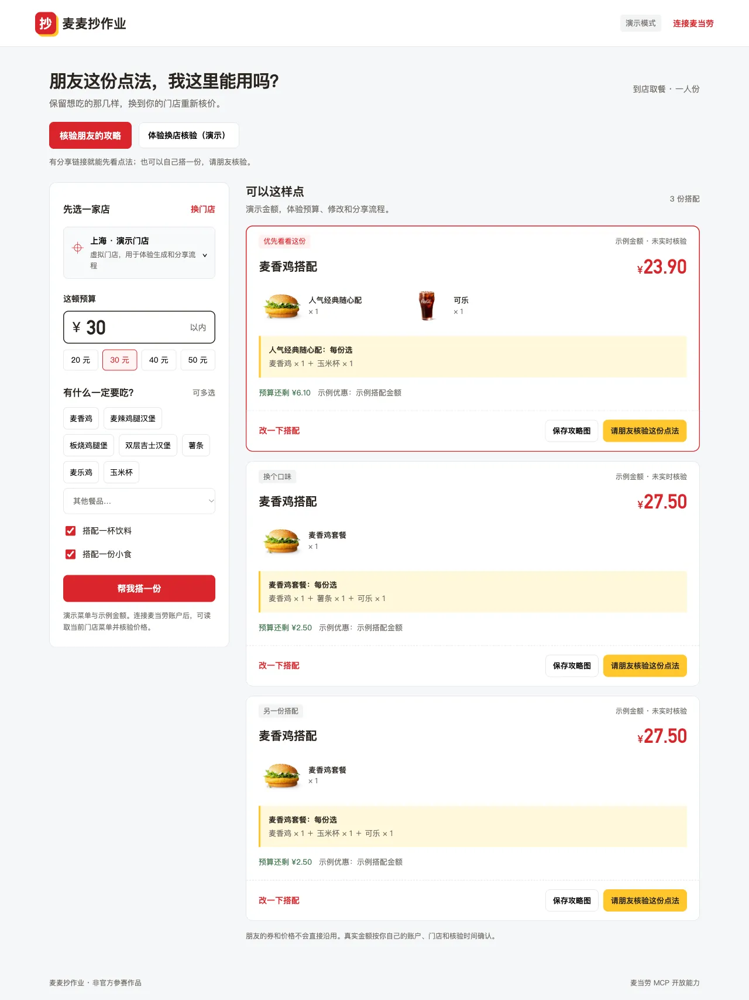
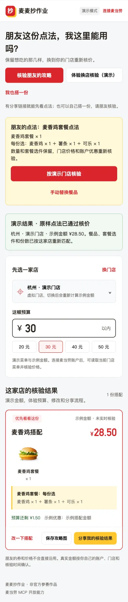
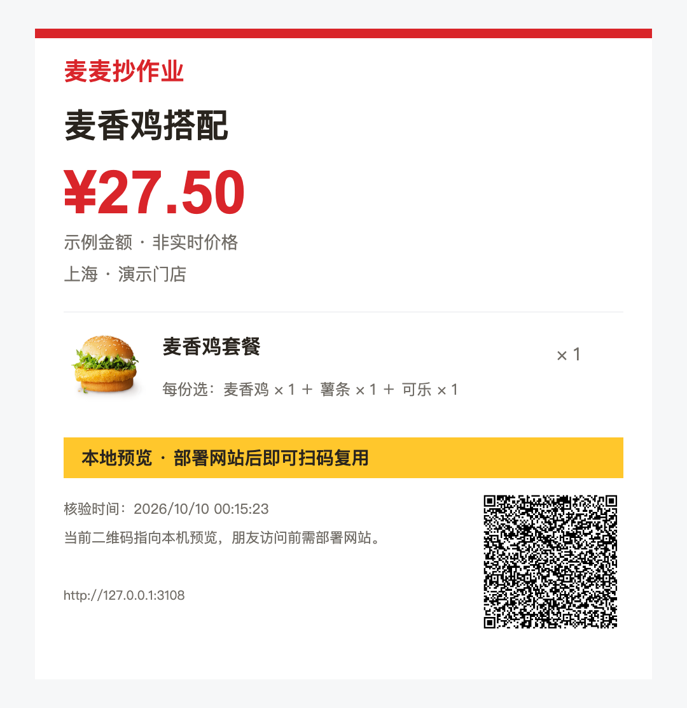

# 麦麦抄作业

**找到预算内的一顿，把具体点法发给朋友。朋友换门店，重新核价就能照着点。**

适合想控制一顿饭预算、保留喜欢餐品的学生和上班族。支持单点、套餐和随心配；套餐里的汉堡、小食、饮料杯型也会一起保留。



## 能怎么用

- **按预算找搭配**：选择必点餐品及饮料、小食要求，最多展示三份已核价结果。
- **套餐内自由改选**：按门店实际可选项换饮料、换小食、改份数，再调用官方计价。
- **发给朋友照着点**：复制具体点法和链接，或保存包含照片、门店、金额来源、核价时间与二维码的攻略图。
- **在自己的门店抄作业**：按名称重新匹配套餐和具体选件，重新核价；缺货显示缺项，超预算显示差额。

无需 Token 即可体验完整演示。真实模式连接麦当劳中国官方 MCP，不依赖 LLM API、数据库或前端构建工具。

## 3 分钟开始

需要 Node.js 22 或 24。

```sh
npm ci
npm start
```

打开 http://127.0.0.1:3107 ，直接体验示例菜单。开发时使用 `npm run dev`。

真实核价：在页面点击“连接麦当劳”，填写你在 [麦当劳开放平台](https://open.mcd.cn/mcp) 申请的个人 MCP Token，再选择城市与门店。Token 只保留在本次页面会话中。

个人本地开发也可复制 `.env.example` 为 `.env.local`，填写 `MCD_MCP_TOKEN` 后重启。该文件不提交到 Git；不要把 Token 放进截图、日志、分享或公开服务配置。

## 一份作业如何复用

1. 设置 30 元预算，选择想吃的汉堡和薯条，生成搭配。
2. 点“改一下搭配”，在套餐里把饮料换成自己喜欢的杯型并重新核价。
3. 点“分享这份作业”或“保存攻略图”。
4. 朋友打开链接，能先看到套餐名称、各轮具体选件与份数；选择自己的门店后点击“按我的门店重算”。
5. 目标门店缺项时，由朋友手动替换；不同门店的价格和券权益分别核验。

链接包含餐品、套餐选件、份数和预算，不包含 Token、门店编码、个人地址、优惠券标识或原店价格。旧版单品分享链接继续兼容。

 

## 已验证的真实点法

2026-10-09 使用官方 MCP 在**上海黄浦华旭国际大厦餐厅**进行开发测试：

| 点法 | 本次官方核价 |
| --- | ---: |
| 人气经典随心配：麦香鸡＋可乐中杯 | ¥13.90 |
| 麦香鸡中套餐：麦香鸡＋中薯条＋可乐中杯 | ¥28.00 |
| 人气经典随心配：麦香鸡＋无糖可口可乐中杯，另加中薯条 | ¥27.40 |

金额只代表该门店、该次核验，不是全国统一报价或长期优惠承诺。推荐搜索限定候选数量，不宣称全局最低价；预算判断始终使用官方计价，菜单展示价只用于排序。详细脱敏记录见 [MCP_INTEGRATION.md](MCP_INTEGRATION.md)。

已按官方 schema 适配商品级券：只匹配券声明的适用商品，分别尝试最多两张券，采用官方核价更低的方案。分享会注明账户券条件，朋友需重新核验自己的权益。测试账户在测试门店返回空券列表，**实际券优惠仍未完成实测**；离线测试金额不作为真实优惠证据。项目只查询和核价，不领券、不下单、不支付。

## 公网部署

已有 [Render 配置](render.yaml) 和 [部署步骤](docs/deploy.md)，保持一套 Node 服务即可。**当前尚未发布公网地址。** 本地链接只适用于运行服务的电脑；部署 HTTPS 后，攻略链接与二维码自动使用网站域名。

公开服务不配置共享账户 Token，每位使用者填写自己的 Token；未连接的访客仍可体验明确标注的演示模式。

## 验证与接入

```sh
npm run check
npm test
npm run inspect:mcp
```

自动测试覆盖预算和套餐内部的必点约束、具体选件、默认特制、商品级券匹配、跨店编码匹配、缺货、价格单位、分享字段剔除及 HTTP 边界。真实 MCP 字段节选作为测试 fixture 保存；自动测试不联网，也不需要凭证。GitHub CI 配置在 Node 22、24 上执行检查与测试。

`inspect:mcp` 需要真实连接，只显示所用工具的输入 schema。接入通过官方 `@modelcontextprotocol/sdk`，使用 `query-nearby-stores`、`query-meals`、`query-meal-detail`、`query-store-coupons`、`calculate-price`。

[SKILL.md](SKILL.md) 是客户端技能入口，[mcp-config.example.json](mcp-config.example.json) 只提供环境变量占位符；变量展开方式取决于客户端。

## 开源与参赛

原创代码拟采用 [MIT](LICENSE) 许可。麦当劳名称、商标和餐品图片归各自权利人所有，不在 MIT 授权范围内；图片来源见 [sources.json](public/assets/sources.json)。演示门店、价格和优惠为测试数据，页面与攻略图均标注。

官方 [CONTEST_DECLARATION.md](CONTEST_DECLARATION.md) 原样保留。此次开发使用 Codex；未使用 WorkBuddy，不提供虚构的专项开发记录。公开仓库和报名状态将在实际发布后更新；报名文案已准备在 [docs/registration.md](docs/registration.md)。

问题反馈请说明：演示或实时模式、发生时间、操作步骤、脱敏错误信息。不要提交 Token、账户资料或含凭证的网络请求。
